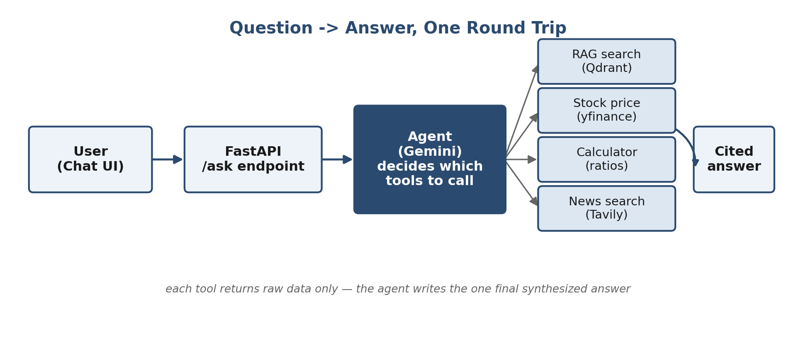
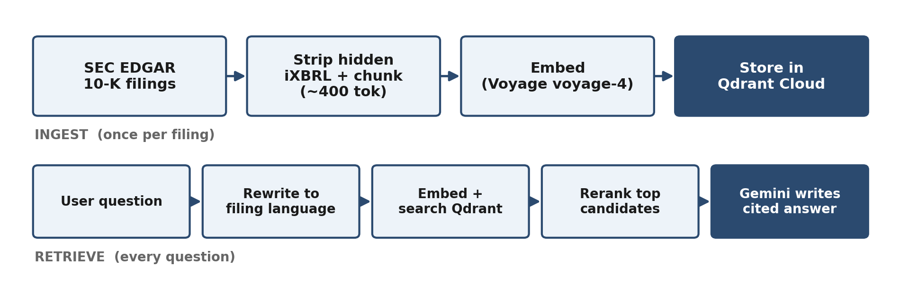
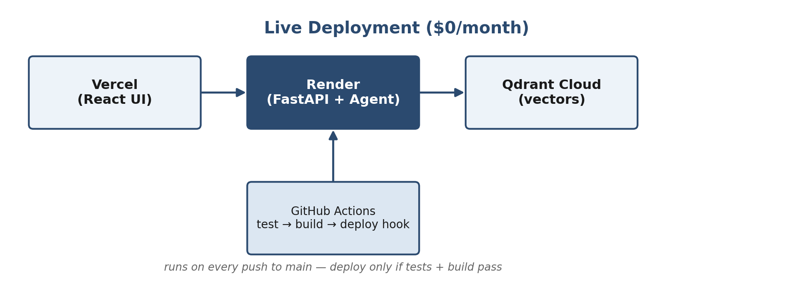

# Finance AI Assistant

An AI agent that answers finance questions about **Apple, Microsoft, and Nvidia** using real, live data instead of model memory — their actual SEC 10-K filings (retrieval-augmented generation), live stock prices, and current news. Ask a question in plain language; the agent decides which tools it needs and returns one cited answer.

The backend is **provider-agnostic**: it runs on **Google Gemini + Qdrant** (the free default) or **Azure OpenAI + Azure AI Search**, chosen with two environment variables — no code changes.

**Live demo:** [finance-ai-ui-vercel.vercel.app](https://finance-ai-ui-vercel.vercel.app/)

[](https://github.com/srisaktic/finance-ai-assistant/actions/workflows/ci.yml)
[](https://github.com/srisaktic/finance-ai-assistant/actions/workflows/ui-ci.yml)



---

## What it does

- Answers qualitative questions from real 10-K filings (risks, strategy, business description) via RAG, with citations
- Looks up live stock prices and key stats
- Computes financial ratios and percentage changes (margins, growth, etc.)
- Searches current news for a company or topic
- Synthesizes all of the above into one grounded answer — never guesses when a tool has no data
- Remembers the conversation, so follow-ups like "and what about Microsoft?" work

## Tech stack

| Layer | Technology |
|---|---|
| Data source | SEC EDGAR — real 10-K filings (AAPL, MSFT, NVDA) |
| Embeddings + rerank | Voyage AI (`voyage-4`, `rerank-2.5`) |
| Vector database | Qdrant Cloud **or** Azure AI Search — switchable (`VECTOR_STORE`) |
| LLM / agent | Google Gemini (`gemini-3.1-flash-lite`) **or** Azure OpenAI (`gpt-4.1-mini`, Responses API) — switchable (`LLM_PROVIDER`); custom tool-calling loop |
| Market data | yfinance |
| News search | Tavily |
| Backend | FastAPI (Python) |
| Frontend | React + TanStack Start (TypeScript) |
| Packaging | Docker + Docker Compose |
| Testing | pytest, ESLint + Prettier (UI) |
| CI/CD | GitHub Actions — tests on every pull request; test → build → deploy on `main` |
| Hosting | Render (API) + Vercel (UI) + Qdrant Cloud or Azure (vectors / LLM) |

## How it works



A question hits `POST /ask` on the FastAPI backend, which passes it straight to the agent loop. The LLM (Gemini or Azure OpenAI, depending on `LLM_PROVIDER`) reads the question against four available tools — `search_filings`, `get_stock_price`, the calculator, and `search_news` — decides which ones actually apply, and the orchestrator executes them. Every tool returns raw data only; synthesis into one coherent, cited answer happens exactly once, after all tool calls return.

The RAG path specifically: filings are chunked (~400 tokens, structure-aware) and embedded once at ingest time. Every question is rewritten into filing-style language, embedded, searched in the vector store (Qdrant or Azure AI Search, depending on `VECTOR_STORE`), reranked against the actual question, and only then handed to the LLM to write the final answer.

## Switching providers

Two environment variables pick the setup. If they're not set, the free default is used.

| Setting | Values | Default |
|---|---|---|
| `LLM_PROVIDER` | `gemini` or `azure` | `gemini` |
| `VECTOR_STORE` | `qdrant` or `azure` | `qdrant` |

How the switch is built:

- **One place per concern.** `generate_text()` in `src/llm_client.py` handles all plain text calls (query rewriting, answer writing, summaries). `run_agent()` picks the Gemini or Azure tool-calling loop. `search()` picks the Qdrant or Azure AI Search backend. Everything else in the pipeline is unchanged.
- **Same result shape.** Azure AI Search results are returned with the same `.id`, `.score`, `.payload` shape as Qdrant, and Azure's score (`1 / (1 + cosine distance)`) is converted back to plain cosine similarity, so scores mean the same thing in both stores.
- **Safe defaults.** Azure clients are only created when Azure is switched on, so the default setup needs no Azure keys at all.
- **Same data in both stores.** `src/ingest/azure_search_store.py` copies all chunks *and their existing Voyage vectors* from Qdrant into an Azure AI Search index — no re-embedding, so the two stores can be compared fairly.

## Provider comparison

Spot checks run on Oct 20, 2026 (a single day, on the Gemini free tier — not a formal benchmark):

| Check | Gemini + Qdrant | Azure OpenAI + Azure AI Search |
|---|---|---|
| Top-5 search results for a sample query | Same 5 chunks, same order | Same 5 chunks, same order (scores within 0.001) |
| Full RAG answer (rewrite → search → rerank → answer) | ~1–2 min | ~3 s |
| Agent question with 2 tool calls (stock price + 10-K search) | ~4.5 min | ~8 s |

Retrieval is identical because both stores hold the same vectors; the speed difference comes from the LLM calls. A fuller comparison over the 15 evaluation questions is planned.

## Deployment



- **Backend:** every pull request runs the test suite and builds the Docker image in GitHub Actions. Every push to `main` does the same, then triggers a deploy to Render via a private deploy hook — only if both succeed. Which provider the live API uses is set by environment variables on Render.
- **Frontend:** Vercel's GitHub integration deploys `main` to production and creates a preview deployment for every pull request. A separate GitHub Action lints and builds the UI on every change under `ui/`.
- **Keep-alive:** Qdrant Cloud is kept from sleeping via a scheduled GitHub Action that pings it every few days.

## Project structure


## Running it locally

**Requirements:** Python 3.12, Bun (or Node.js), and a free API key each from Voyage AI, Google AI Studio (Gemini), Tavily, and Qdrant Cloud. Azure is optional.

1. Clone the repo and create a `.env` file in the project root with the following keys (get each from its respective provider — do not commit this file):
```
VOYAGE_API_KEY=
GEMINI_API_KEY=
TAVILY_API_KEY=
QDRANT_URL=
QDRANT_API_KEY=

# Optional: choose providers (defaults shown)
LLM_PROVIDER=gemini
VECTOR_STORE=qdrant

# Only needed when LLM_PROVIDER=azure
AZURE_OPENAI_ENDPOINT=https://<your-resource>.services.ai.azure.com/openai/v1/
AZURE_OPENAI_API_KEY=
AZURE_OPENAI_DEPLOYMENT=

# Only needed when VECTOR_STORE=azure
AZURE_SEARCH_ENDPOINT=https://<your-search-service>.search.windows.net
AZURE_SEARCH_API_KEY=
AZURE_SEARCH_INDEX=finance-filings
```

2. Install backend dependencies and ingest the filings:

```bash
   python -m venv venv && source venv/bin/activate
   pip install -r requirements.txt
   python scripts/run_ingest.py
```

   **Using Azure AI Search?** After the ingest above, copy the chunks into Azure once:

```bash
   python -m src.ingest.azure_search_store
```

3. Run the API:

```bash
   uvicorn src.api.main:app --reload
   # -> http://localhost:8000/docs for interactive API docs
```

4. Run the frontend:

```bash
   cd ui
   bun install
   bun run dev
```

**Or run the backend with Docker:**

```bash
docker compose up --build
```

## Testing

```bash
python -m pytest
```

Covers the pure, dependency-free functions (calculator, ticker detection) — no paid or rate-limited API calls run in CI. CI runs with no Azure keys, which also checks that the default (Gemini + Qdrant) setup never depends on Azure.

```bash
cd ui
bun run lint
bun run build
```

Lint (ESLint + Prettier) and build checks for the frontend — the same checks the UI GitHub Action runs.

## Cost

- **Default setup (Gemini + Qdrant):** runs entirely on free tiers — Gemini, Voyage AI, Qdrant Cloud, Tavily, Render, and Vercel. Realistic total: **$0/month**.
- **Azure setup:** Azure AI Search runs on the Free tier. Azure OpenAI is billed per token, which is small for demo traffic and was covered by Azure's new-account credit. A budget alert is set on the Azure subscription.

## Known limitations

- Retrieval can still miss content nested in an unlabeled sub-section of a 10-K item (documented, not silently broken)
- Render's free tier cold-starts after 15 minutes of inactivity — first request after idle time is slow
- Test coverage is scoped to pure functions, not the full RAG/agent pipeline
- Conversation memory is provider-specific: after switching `LLM_PROVIDER`, start a new conversation
- The Azure AI Search index is a copy of Qdrant's vectors — re-run `azure_search_store` after re-ingesting filings. Free-tier search services may be removed after long inactivity.

## Documentation

Full build narrative and a decision-by-decision log (alternatives considered, real bugs hit, and why each call was made) are included in this repo as `Project_Documentation.pdf` and `Detailed_documentation.pdf`. These cover the original Gemini + Qdrant build; the Azure provider layer is described in this README.

## Author

Sri Sakticharan
